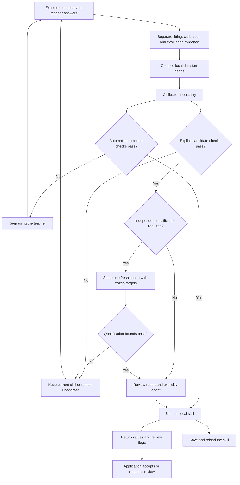

# System 1: Instinct architecture and implementation

Implementation reference for **System 1: Instinct 1.0.0**, reviewed 14 October 2026.
See the [6-category benchmark gauntlet report](../../benchmarks/quality/v1_4_gauntlet_report.md),
[drop-in guides](../drop_in/README.md) and
[changelog](../../CHANGELOG.md) for version boundaries.
The [whitepaper](../paper/system1_whitepaper.md) explains the product and evidence;
this document maps its behavior to the source. The package version is defined in
[pyproject.toml](../../pyproject.toml).

## The product loop

A skill maps a bounded input to a declared set of outputs. A teacher supplies
labels; the local compiler learns a small numerical decision head over fixed
features. Teaching can use a file of reviewed examples or observations of an API,
LLM, rule, or callback. The default path does not download or fine-tune a language
model. Optional research adapters can supply features from fixed pretrained text
encoders; their weights and runtime costs belong to that adapter's deployment.

This diagram describes the lifecycle. A single `decide()` call returns a decision;
it does not run the teacher, execute a tool, or perform the entire lifecycle.

## Components and actual defaults

| Component | Responsibility | Source |
|---|---|---|
| `DecisionSchema` and field classes | Choice, Boolean, MultiChoice and continuous score outputs; field-level review configuration | [schema](../../src/system1/core/schema.py) |
| `DeterministicSemanticProjector` | SHA-256-derived signed word, subword, character and concept-aware features, normalized into 384 dimensions by default | [core model](../../src/system1/core/model.py) |
| `TfidfProjector` | Optional fitted word unigram/bigram and character n-gram vocabulary with document-frequency or supervised $\chi^2$ feature selection, smoothed IDF and sublinear term frequency; frozen during inference and saved in the skill | [text features](../../src/system1/core/text.py) |
| `HybridProjector` | Optional hashed or fitted $\chi^2$ TF-IDF lexical features plus a seeded or corpus-fitted spectral (PPMI + truncated SVD) dense subspace with curated semantic anchors | [embeddings](../../src/system1/core/embeddings.py) |
| `SystemOneCompiler` | Validate labels, partition examples, fit ridge or optional logistic choice heads (with optional two-stage hierarchical routing for high-cardinality fields), calibrate (marginal or Mondrian per-class LAC plus dual OOD familiarity and prototype similarity gates), serialize | [compiler](../../src/system1/compiler.py) |
| `TeachingSession` (since 1.1.0; multi-field in 1.4.0) | Retain explicit lessons and groups across `ChoiceField`, `BooleanField`, `MultiChoiceField` and `ScoreField` (`split="auto"` stratified routing); assess, independently qualify, explicitly adopt and restore exact approved revisions | [teaching lifecycle](../../src/system1/teaching.py) |
| `BoundedReviewFallback` | Bounded teacher fallback runner with optional closed-loop lesson recording (`auto_record_lessons=True`) and sub-millisecond online RLS updates (`auto_online_update=True`) | [fallback runner](../../src/system1/fallback.py) |
| `System1Engine` / `SystemOneEngine` | Apply a schema or compiled skill, uncertainty checks, calibration-preserving online RLS updates (`learn_from_tier2`), optional caching and audit evidence | [engine](../../src/system1/engine.py) |
| TypeSafe `Client` / `AsyncClient` | Teacher observation, optional background compilation (`background_compile=True`), per-schema promotion, local typed responses, `TeachingSession` export and skill reuse | [adapter](../../src/system1/compat/typesafe.py) |
| `PolicyEngine` / `SystemOneGuard` | Explicit permissions and guarded proposal evaluation | [guard](../../src/system1/guard.py) |
| Receipts / `ActionLedger` | Software signatures and a local hash-chained event record | [receipts](../../src/system1/receipt.py), [ledger](../../src/system1/ledger.py) |

The deterministic projector uses words, character 3/4-grams within words, adjacent
word pairs, cross-word character 4-grams and concept-aware cluster channels. Its hashes are SHA-256, not MurmurHash;
there is no corpus-fitted IDF or pretrained contextual language model. Positional
weighting is built in; recency weighting is optional. Shared lexical features
allow generalization to new combinations, and cold-start `ChoiceField` compilation
additionally performs sibling-contrastive stem IDF weighting and multi-exemplar
sub-prototype scoring across semicolon/clause-delimited option descriptions.

`HybridProjector()` defaults to 1,024 lexical and 256 dense dimensions with mixing
weight 0.5 and seed 42, while `HybridProjector.fit(...)` learns a supervised $\chi^2$
word + character n-gram sparse block and a spectral PPMI + truncated SVD dense
subspace directly from teaching examples. It is an optional
representation, not the compiler's default or an independently learned language
understanding system.

The compiler defaults to 384 features, ridge regularization 1.0 and NumPy.
Published explicit-teaching workloads use 2,048 features and regularization 0.1;
the original automatic-observation experiments use regularization 1.0. Later
quality-round and v1.4 gauntlet recipes state their own settings. `TeachingSession` defaults
to fitted TF-IDF with at most 1,024 features, ridge regularization 0.1, strict
`alpha=0.05` and disabled inference caches. These are distinct paths; their
settings and measured costs must not be conflated. Since 1.2.0, its ridge or
optional logistic choice solver is saved when the session is created; reopening
with a different explicit solver is rejected. Existing 1.1.0 sessions retain ridge.

## Teaching and calibration

`compile(examples, augment=False)` uses supplied labels only. Python compilation
retains `augment=True` as its legacy default; the CLI with `--dataset` and the
normal observation adapter default to examples-only teaching. Missing classes,
unknown fields and malformed labels are errors. Schema templates are useful
starter data, not independent observations.

The compiler reserves about 25% of unique prompts for calibration unless explicit
`calibration_exemplars` are provided. Repeated normalized prompts stay together.
Categorical, Boolean and MultiChoice calibration separate temperature fitting
from conformal scoring. Application-defined related groups need to be split by
the caller; ordinary compilation cannot discover paraphrases or shared sources.
Evaluation data must stay outside both fitting and calibration.

The default ridge fitting code augments features with a bias column and solves regularized
normal equations. It currently computes a NumPy inverse and multiplies by the
cross-product, with pseudoinverse/least-squares fallback on `LinAlgError`.
It does not use the Cholesky implementation described in earlier drafts.
Stored inference weights have shape `(number_of_outputs, feature_dimension)`.

The Python compiler also accepts `choice_solver="logistic"` for ChoiceField
heads. It minimizes summed cross-entropy plus `regularization / 2 * ||W||²`,
with an unpenalized bias, using SciPy L-BFGS-B from the optional `teaching` extra.
Stored coefficients are scaled by 0.25 to match the existing runtime's logit
scaling. Calibration, portable head format and NumPy inference are shared with
the ridge path. Other field types retain their existing fitting methods; no
optimizer object is serialized. This is an optional teaching method, not a new
claim of workload quality or a change to automatic-observation defaults.

## Local decisions and uncertainty

`System1Engine` is an alias of `SystemOneEngine`. Both `system1` and legacy
`reflex` imports expose the same implementation. Install the `system1`
distribution and use the `system1` CLI; the unrelated Reflex web framework is a
different distribution.

Direct Python engines default to `strict_mode=False` for compatibility. For a
taught skill, use `strict_mode=True`; saved-model CLI decisions and normal
observed skills use strict review. A returned best-guess value can still need
review. `ambiguous_fields` records field uncertainty, while `escalated_fields`
contains the fields configured to affect the overall `is_ambiguous` flag.

Examples-only categorical/Boolean teaching uses LAC scores; legacy and augmented
skills retain APS scores. Strict mode inverts the saved score definition.
MultiChoice checks a unique complete assignment, including an empty assignment
when supported by evidence. Score fields have their own interval/review behavior.
The categorical singleton rule must not be described as every field's contract.

Non-strict mode includes confidence and margin heuristics. Strict mode does not
permit those heuristics to bypass inadequate conformal evidence. Prediction-set
coverage is marginal under exchangeability, not accuracy conditional on local
acceptance or permission to execute an action. See the [mathematical note](../paper/conformal_gating.md).

The cache supports exact and vector lookup primitives. Compiled inference and
engine cache checks bind results to the input, telemetry and model state; nearby
text cannot substitute for a distinct compiled prediction. Cache hits do not
certify an action. The public workload timings disable caches and receipts.

## Observation and automatic promotion

The [adapter contract](../typesafe.md) is the detailed reference. In
`mode="auto_cutover"`, teacher answers continue until that schema's candidate
qualifies. By default (`background_compile=False`), compilation and transition are
synchronized in the request path; when `background_compile=True` (since 1.4.0),
candidate compilation and promotion checks run asynchronously on a background
worker thread while active requests continue to return teacher responses without
blocking (`wait_for_compilation()` synchronizes in tests or shutdown hooks, and
`export_teaching_session()` exports observed history into a `TeachingSession`).

Defaults are a 50-observation earliest attempt, 80% agreement, 80% local acceptance,
95% statistical confidence and zero observed critical false-allows. Candidates
are checked on disjoint, fresh validation groups, using complete output agreement
and agreement among accepted responses. Exact one-sided binomial lower bounds
and a summable budget across attempts constrain repeated promotion checks.
Independent representative groups are still required for statistical meaning.

Since 1.0.2, `PromotionPolicy(min_accepted_agreement=.95)` optionally requires
both point agreement and an exact lower bound on accepted validation groups.
The three exact bounds share the repeated-attempt confidence budget. This
measures teacher agreement, not independent correctness. Sync and async adapters
also expose the compiler's existing `regularization` setting (default 1.0).
See [qualification settings and evidence](../typesafe.md#what-promotion-means).

A promotion threshold is not a promised number of teacher calls. The gate's 80%
thresholds are also not the separate 95% accepted-correctness workload target.
The assistant, banking and SMS experiments demonstrate why the distinction matters.

Promotion and drift state are per schema. A local response can still request
review. Fallback is explicitly configured; `zero_egress=True` prevents the
adapter's own HTTP fallback, not network calls made by a user callback or tool.

## Persistence and corrections

Format-v2 `.s1m` files contain schema, projector configuration, weights, temperature,
calibration scores and score semantics; adapter exports retain evaluated review
settings. Built-in projectors, including the optional fitted TF-IDF vocabulary, can be reconstructed. External projectors must be
supplied and should expose a configuration digest. Readers validate versions,
shapes, schema identity and finite numerical values. The 1.1.0 reader also supports v1
skills with legacy APS semantics; 0.2.x readers cannot read v2. TF-IDF skills
require a 1.1.0-or-newer reader even though they use the existing v2 container.

The loader bounds file/header size, schema complexity, compressed and expanded
arrays, and runtime allocation before materializing arrays or projectors. It
checks NPY shapes and floating-point types before NumPy loading, including
covariance and calibration state. See the [exact budgets](../deployment.md#saved-skill-resource-limits).

Saving a validated skill is tested to preserve values, probabilities, prediction
sets and review flags. By default (`preserve_calibration=False`), online correction
methods including `learn_from_tier2` and its aliases invalidate changed heads'
calibration and caches so separate recalibration is required before strict acceptance.
Since 1.4.0, `learn_from_tier2(..., preserve_calibration=True)` (used by
`BoundedReviewFallback(..., auto_online_update=True)`) applies exact Sherman-Morrison
directional gain scaling to update the target class margin while preserving existing
conformal quantiles for immediate online boundary adaptation. Retaining examples and
recompiling remains the primary reproducible update process.

The additive `TeachingSession` helper introduced in 1.1.0 (and expanded in 1.4.0)
implements that process for single-field or multi-field schemas across `ChoiceField`,
`BooleanField`, `MultiChoiceField` and `ScoreField` where at least one field has
`escalate_on_ambiguity` enabled.
The helper rejects a schema that suppresses all review flags. Separate `teach`,
`calibrate`, and `evaluate` records (or `split="auto"` deterministic 60%/20%/20%
stratified routing) feed a TF-IDF or `HybridProjector` candidate with the session's
fixed ridge or optional logistic solver, strict
uncertainty calibration, and recurring comparison
checks. Assessing does not replace the current skill; adopting rechecks the exact
artifact and evidence identities. Corrections to the same normalized input replace
the lesson. Its report separates raw errors, accepted errors, reviews and losses
of previously accepted correct decisions. Repeated checks are development evidence,
not independent qualification. Since 1.2.0, supplied related-document groups must
also stay within one split. Normalized text and explicit groups cannot identify
every paraphrase or shared source. This is a single-writer local workspace over the
existing compiler and `.s1m` format, with no change to their defaults or algorithms.
Its default adoption checks require raw accuracy ≥80%, acceptance coverage ≥50%,
zero accepted errors and zero useful regressions. These empirical checks differ
from automatic teacher promotion, conformal coverage and workload qualification.
In the [BBC workflow test](../../benchmarks/quality/document_workflow/README.md),
all three candidates are refused despite some meeting separate holdout quality
targets; no approved skill is created. See the
[shared workflow](../guides/correcting_skills.md) for explicit threshold settings
and the report contract.

In 1.2.0, `assess(require_qualification=True)` adds a fresh-data gate without
weakening the development checks. `qualify()` freezes one supplied cohort,
provenance and targets before scoring the exact assessed candidate. One row per
independent supplied group is required; qualification inputs and identified groups
cannot overlap session records or earlier consumed cohorts. A candidate gets one
request, including failed or interrupted requests. Consumed inputs and groups
cannot later become lessons. Independent representative sampling remains the
caller's responsibility; software cannot establish it from uploaded labels.

Qualification separately checks exact one-sided binomial lower bounds for
accepted correctness and acceptance coverage. Confidence is fixed across the
session's attempts; at attempt `k`, each bound spends
`(1 - confidence) / (2 * k * (k + 1))`. The summable budget applies across the
retained qualification attempts, under the required sampling assumptions.
Defaults require lower bounds of 0.95 accepted correctness and 0.8 coverage,
at confidence 0.95. No accepted evidence prevents qualification. The mathematical
note distinguishes this gate from reused development bounds and conformal sets.

Explicit adoption revalidates any required qualification and archives exact
approved `.s1m` bytes with their assessment and qualification evidence.
`rollback(revision)` validates the retained artifact and required evidence,
restores those bytes, keeps current lessons, and invalidates the pending assessment.
Legacy approved skills are preserved without inventing a missing assessment or
retroactive qualification. `decision_details()` exposes the approved revision,
prediction set and observable review conditions; it does not call a teacher,
automatically label predictions, or explain the cause of a classification error.
These additions introduce no new encoder or lesson-selection algorithm and do
not change the full-scope workload requirements.

Optional recursive least-squares updates use retained covariance state where
available. Their forgetting and numerical stabilization differ from unweighted
batch equivalence in ideal arithmetic. No fixed update-latency guarantee is made.

## Permissions, audit and integrations

Classification is separate from deterministic authorization. Use
`SystemOneGuard(enforcement_profile=True)` with explicit grants, a signing key
and durable ledger. The application supplies authenticated identity and executes
only the authorized operation. The library is an in-process hook, not an OS
sandbox or hardware execution proof.

Receipts use software Ed25519 signatures. The SQLite ledger is a linear SHA-256
hash chain. Trusted keys and external head checkpoints are needed to assess
provenance and rollback; neither artifact proves a tool executed correctly.
Receipts and ledgers are optional on ordinary classification paths.

Receipt authentication requires an independently supplied public key. Diagnostic
integrity checks do not authenticate a signer. After append, the existing signed
envelope binds the committed ledger record ID while the core receipt digest stays
stable. Guards check exact stored receipt inclusion; write transactions reverify
the complete chain. See [deployment boundaries](../deployment.md).

LangChain, MCP, ASGI, gRPC, Prometheus and OpenTelemetry are adapters around these
contracts. gRPC's diagnostic CLI has insecure transport and defaults to loopback.
Remote schema selection is restricted to built-ins and exact startup registrations;
file/import/inline-JSON loading belongs to the trusted local CLI path.
Experimental container templates exist but no published image or authenticated
service is supplied. Read [deployment boundaries](../deployment.md) and
[observability](../observability/README.md) before exposing an endpoint.

The base distribution depends on NumPy and cryptography. The isolated `system1.core`
layer can run with NumPy alone. Optional MLX/neural and emulator paths are
experimental; they are not dependencies of the demonstrated teaching workflow.
